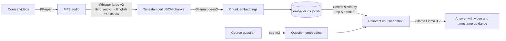

# CourseLens

### Ask questions about a course. Get answers grounded in its videos.

CourseLens is a local, retrieval-augmented question-answering prototype for a JavaScript video course. It transcribes course audio, indexes subtitle-sized chunks, finds the most relevant moments for a question, and asks a language model to explain where to find the answer.

Instead of searching through an entire lesson, ask a course-related question and get a concise answer with video numbers and timestamps to revisit.

<p align="center">
  
  
  
  
  
  
</p>

## At a glance

- **Course-focused retrieval:** searches transcript chunks rather than asking the model to reason over an entire video.
- **Timestamp-aware answers:** retrieved chunks include the lesson number and start/end times.
- **Runs locally:** embeddings and answer generation use a local Ollama service; transcription uses Whisper.
- **Simple, inspectable pipeline:** intermediate transcripts, the final prompt, and the answer are saved as files.

## How it works



1. Convert course videos to audio.
2. Transcribe and translate the audio into timestamped text chunks.
3. Embed the chunks and save them in a local index.
4. Embed a question, rank chunks by cosine similarity, and retrieve the top five.
5. Generate an answer using the retrieved context.

## Technology

| Role | Tool or model |
| --- | --- |
| Video-to-audio conversion | [FFmpeg](https://ffmpeg.org/) |
| Transcription and translation | [OpenAI Whisper](https://github.com/openai/whisper), `large-v2` |
| Local model runtime | [Ollama](https://ollama.com/) |
| Text embeddings | `bge-m3` via Ollama |
| Answer generation | `llama3.2` via Ollama |
| Similarity search | scikit-learn cosine similarity |
| Data handling and storage | pandas, NumPy, joblib |

## Getting started

### Prerequisites

- Python 3
- [FFmpeg](https://ffmpeg.org/download.html), available on `PATH`
- [Ollama](https://ollama.com/download) installed and running
- Enough disk space and compute for Whisper `large-v2` and the Ollama models

Pull the models used by the scripts:

```powershell
ollama pull bge-m3
ollama pull llama3.2
```

Install the Python dependencies from the project directory:

```powershell
python -m venv .venv
.\.venv\Scripts\Activate.ps1
python -m pip install --upgrade pip
python -m pip install openai-whisper requests pandas numpy scikit-learn joblib
```

Whisper may require additional platform-specific setup for PyTorch. Follow the [Whisper installation instructions](https://github.com/openai/whisper#setup) if installation fails.

### Prepare course files

1. Put `.mp4` course videos in `Videos\`. The converter expects names such as `Lec 01 - Introduction.mp4`.
2. Convert the videos:

   ```powershell
   python "process_video (video to mp3).py"
   ```

3. Put the resulting MP3 files in `audios\` using this naming format:

   ```text
   <number>.<lesson title>.mp3
   ```

   For example: `1.Introduction.mp3`.

   **Important:** the video converter currently writes names like `01_Introduction.mp3`, while the transcription script expects a numeric prefix followed by a period. Rename the generated files to the format above before continuing.

### Build the transcript index

Transcribe each audio file and create timestamped JSON:

```powershell
python "create_chunks (mp3 to json).py"
```

The script uses Whisper `large-v2` with Hindi as the source language and translation to English. It writes transcript files to `jsons\` and skips audio files whose JSON output already exists.

Create embeddings and save the searchable index:

```powershell
python "read_chunks (preprocess json).py"
```

This sends transcript chunks to the local Ollama `bge-m3` embedding model and writes `embeddings.joblib`.

### Ask a question

Make sure Ollama is running and both models are available, then start the question-answering script:

```powershell
python process_incoming.py
```

Enter a question about the course when prompted. The script retrieves the five most similar transcript chunks, sends them with the question to `llama3.2`, prints the response, and writes the generated prompt and answer to `prompt.txt` and `response.txt`.

## Project layout

```text
.
├── Videos/                           # Source course videos (.mp4)
├── audios/                           # Extracted audio files (.mp3)
├── jsons/                            # Timestamped transcript chunks
├── embeddings.joblib                 # Serialized chunk and embedding index
├── process_video (video to mp3).py   # Extract audio with FFmpeg
├── create_chunks (mp3 to json).py    # Transcribe and translate with Whisper
├── read_chunks (preprocess json).py  # Embed transcript chunks with Ollama
└── process_incoming.py               # Retrieve context and generate answers
```

Generated data and model files are local project artifacts; they are not included in the source code workflow.

## Current scope and limitations

- The question-answering prompt is written for a JavaScript course and asks the model to decline unrelated questions.
- Retrieval uses cosine similarity over the five nearest transcript chunks; it does not currently use a vector database or a configurable retrieval threshold.
- The transcription script is configured for Hindi audio translated into English. Change its Whisper options if your source course uses another language.
- The scripts expect to be run from the project directory and depend on the local `audios\`, `jsons\`, and Ollama service being available.
- The audio naming formats produced and consumed by the current scripts differ; follow the rename step above before transcription.

## Contributing

Contributions that improve setup clarity, indexing reliability, retrieval quality, or timestamp-grounded answers are welcome. For a change, include a short description of the problem it solves and steps to reproduce or verify it.

## License

No license file is currently included. Add a `LICENSE` file before redistributing or accepting contributions under specific terms.
